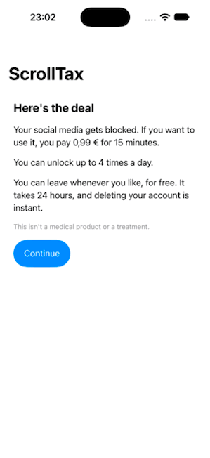

# ScrollTax (working name)



*The real app running in the iOS Simulator in demo mode (pretend blocker, pretend purchase, local test backend). No real money, no real blocking.*

Site: https://abozaralizadeh.github.io/ScrollTax/

Source available, free for non-commercial use ([PolyForm Noncommercial 1.0.0](LICENSE)). Commercial use needs written permission. Ask by opening an issue.

A phone app for people who want less social media. You sign up, your social media gets blocked, and to open it you pay a small amount for a short window of time. When the time is up, the block comes back.

It's an early project. It isn't released, it takes no real money, and some parts have never run on a real iPhone (see "What works" below).

## How it works

- You join by choice and can leave for free, after a wait.
- The phone does the blocking and unlocking with Apple's Screen Time tools, so it keeps working when the server is down.
- A small backend keeps accounts, payment records and the daily limit.
- The deal's numbers (price, minutes, daily limit, leave wait, minimum age) are settings in `backend/.env`, and the app reads them from the backend.

## What works

| Part | State |
| --- | --- |
| Backend (accounts, payments, daily limit, refunds, leave, delete, data copy, report) | Working and tested |
| Swift rules (unlock window, daily limit, leave wait, offline queue, wrong phone clock) | Working and tested with fake clocks |
| iPhone app and its three Screen Time extensions | Builds for the simulator. A UI test walks the whole flow in demo mode. Real blocking needs Apple's Family Controls approval and a real iPhone, so it hasn't been run |
| Sign in with Apple and App Store purchases | Written and tested against locally made keys only. Never run against Apple |
| Legal pages | Drafts, not legal advice |
| Server setup script | Written and shellchecked, never run on a VM |

Nothing paid is ever called. Everything that needs an Apple account sits behind an interface with a local fake, and payments only work in sandbox or test mode.

## Quick install

You need Node 24 or newer. For the iPhone app you also need Xcode and [XcodeGen](https://github.com/yonaskolb/XcodeGen).

Backend:

```bash
cd backend
npm install
cp .env.example .env
```

Put a long random string in `SESSION_SECRET` (`openssl rand -hex 32` makes one), then:

```bash
npm run dev
```

It starts in fake Apple mode on `http://127.0.0.1:8787`.

iPhone app:

```bash
cd ios
xcodegen generate
open ScrollTax.xcodeproj
```

Run it in the simulator with the backend going. The simulator starts in demo mode, with a pretend blocker and a pretend purchase.

To put the backend on a Debian or Ubuntu server, see `setup_service.sh`. Run it as root. The first run installs everything, and running it again updates and restarts. Add `DOMAIN=api.example.com` for HTTPS with Caddy. Logs: `journalctl -u scrolltax.service -f`.

## Run the tests

```bash
cd backend && npm test && npm run typecheck
cd ios/Packages/ScrollTaxCore && swift test
```

The UI test needs the backend running with `APPLE_MODE=fake` on port 8787:

```bash
cd ios && xcodebuild test -project ScrollTax.xcodeproj -scheme ScrollTax \
  -destination 'platform=iOS Simulator,name=iPhone 18 Pro' \
  CODE_SIGN_IDENTITY=- CODE_SIGNING_REQUIRED=NO CODE_SIGN_STYLE=Manual DEVELOPMENT_TEAM=
```

## Placeholders to replace

If you build this yourself, swap these for your own: the bundle IDs `app.scrolltax*`, the app group `group.app.scrolltax`, `DEVELOPMENT_TEAM` in `ios/project.yml`, and the `[...]` gaps in `web/*.html`.

## More docs

- [docs/DESIGN.md](docs/DESIGN.md): architecture, stack, data model, screens, API and the reason for each technical choice
- [docs/LOGICAL-FLOW.md](docs/LOGICAL-FLOW.md): the main flows, step by step, with diagrams
- [docs/DATA.md](docs/DATA.md): the personal data the backend and the phone hold

## Contributing

Issues and pull requests are welcome. Please keep changes small, run the tests above first, and read [CONTRIBUTING.md](CONTRIBUTING.md). Contributions are accepted only if you agree that the author may relicense them, commercially too.

## License

Source available, free for non-commercial use, under the [PolyForm Noncommercial License 1.0.0](LICENSE). That means you can read, run, study and change it for non-commercial purposes. It is not "open source" in the strict sense, because commercial use isn't allowed without written permission. To ask for permission, open an issue on this repo.

Third-party packages keep their own licenses, see [THIRD_PARTY_NOTICES.md](THIRD_PARTY_NOTICES.md).
