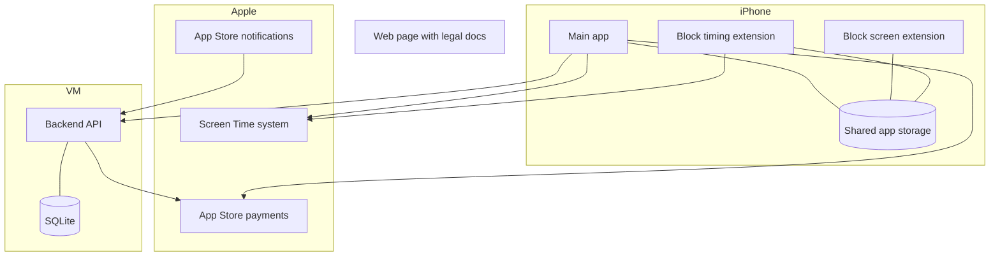
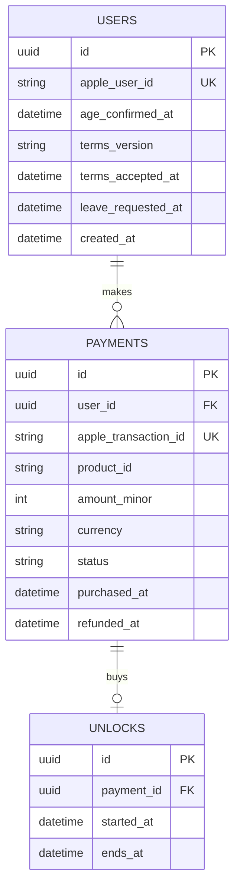

# Design

The design for the first version. What's written here about Apple's tools comes from how they're known to work. It still has to be confirmed on a real iPhone.

## Architecture

There are three parts: the iPhone app, Apple's systems, and a small backend. The phone does the real work. The backend only keeps accounts and records, so the block and unlock don't depend on it.

| Part | Job |
| --- | --- |
| Main app | Registration, picker, payment, countdown, history, leaving |
| Block screen extension | Shows our own wording on Apple's block screen |
| Block timing extension | Puts the block back when an unlock ends |
| Shared app storage | Lets the app and its extensions share state on the phone |
| Backend | Accounts, payment records, daily limit check, refunds |
| Web page | Privacy policy, terms and support contact, which the App Store requires |

## What's in the repo

| Folder | What it is |
| --- | --- |
| `backend/` | The backend. Fastify on Node 24, SQLite through Node's built in `node:sqlite`, tests with `node --test` |
| `ios/Packages/ScrollTaxCore/` | The rules as plain Swift, with no Apple frameworks: unlock and limit logic, leave wait, saved state, API client, offline queue. This is the part with real tests |
| `ios/App/` | The SwiftUI app |
| `ios/Shared/` | Screen Time code used by the app and its extensions |
| `ios/ShieldConfig/`, `ios/ShieldAction/`, `ios/Monitor/` | The three Screen Time extensions |
| `ios/project.yml` | The Xcode project, made with `xcodegen generate` |
| `web/` | Draft privacy, terms and support pages. The backend serves them at `/legal/...` |
| `deploy/` | systemd units and a Caddy example. `setup_service.sh` installs them |

## Things that are faked until real accounts exist

Everything that needs an Apple account sits behind an interface, with a local fake next to the real version.

| Needs | Real version | Local stand in |
| --- | --- | --- |
| Sign in with Apple | `RealApple.verifyIdentityToken` checks the token against Apple's published keys | `FakeApple` accepts `fake-user:<name>` |
| App Store purchases | `RealApple.verifyTransaction` checks the signed transaction against Apple's root certificate | `FakeApple` accepts made up transactions |
| Refund notices | `RealApple.verifyNotification` | `FakeApple` |
| Blocking apps | `RealBlocker` (FamilyControls, ManagedSettings, DeviceActivity) | `DemoBlocker`, used in the simulator |
| Paying | `StoreKitPurchaser` | `DemoPurchaser`, plus `ScrollTax.storekit` for Xcode's local StoreKit testing |

`APPLE_MODE=fake` in the backend's `.env` turns the fakes on and is the default. `APPLE_ENVIRONMENT=Sandbox` is also the default, and the real verifier refuses production transactions, so a mistake can't take real money while the project is sandbox only.

## Tech stack

| Area | Choice | Why |
| --- | --- | --- |
| iPhone app | Swift and SwiftUI | Apple's Screen Time extensions need native code |
| Blocking | FamilyControls, ManagedSettings, DeviceActivity | Apple's own tools for this job |
| Payments | StoreKit 2, consumable product | Required for this kind of purchase, and it's simple |
| Sign in | Sign in with Apple | No passwords, and little personal data |
| Minimum version | iOS 17 | Covers most iPhones without old workarounds |
| Backend | TypeScript with Fastify | Small, and Apple has an official server library for Node |
| Database | SQLite with nightly backups | One VM and little data. Move to Postgres if it ever needs more |
| Hosting | One small Linux VM with systemd | Cheap and simple to run |
| Web server | Caddy | Automatic HTTPS |
| Logs | journald plus a rotating log file capped at 50 MB | Live logs on the VM and a file that's easy to copy |

## Data model

### On the backend

- `payments.user_id` becomes empty when an account gets deleted, so records kept for tax no longer point to anyone.
- `payments.status` is `paid` or `refunded`.
- The Apple transaction ID is unique, so sending the same purchase twice does nothing.

### On the phone

- The person's picks, as Apple's private tokens
- Whether the block is on, and the current unlock's end time (also kept on the phone's uptime clock, see "Wrong clocks" below)
- Today's unlock count, and the backend's last count for today
- The backend's time at the last check, and the latest time the phone has seen
- When leaving started, if it has
- A queue of transactions waiting to reach the backend

### Wrong clocks

Someone can change the date on their phone. The block has to keep working offline, so the phone can't just ask the backend every time. Four things work together:

- **The unlock timer runs on the uptime clock.** Inside one boot, the end of an unlock is stored as a point on the phone's uptime clock (`CLOCK_MONOTONIC`, which keeps counting in sleep). The date in Settings has no effect on it, forwards or backwards.
- **After a restart** uptime starts again from zero, so the date is all there is. If the date has been moved back past the latest time the phone has seen, the unlock ends. That is the safe side: the block comes back, and the person can pay again.
- **The backend's time.** On launch, and when the app comes to the front (at most every 10 minutes), the phone asks `GET /v1/me` (or `GET /v1/time` before sign in), and stores the server time next to the uptime at that moment. From then on, inside the same boot, "now" is the server time plus the uptime that has passed. The daily limit and the leave wait use it, and the home screen says when the phone's date looks wrong.
- **The backend's count.** `GET /v1/me?tz=` tells the phone how many unlocks the backend has for today, counted from Apple's purchase dates. The phone uses the larger of its own count and that one, so a changed date or a reinstall (which wipes the phone's list) can't give extra unlocks while the phone can reach the backend.

The rules live in `Clock.swift` and `AppState.swift` in the Swift package and are tested with fake clocks. The uptime clock itself (`ClockSample.current()`) has not been tried on a real iPhone.

### What we never store

- Which apps or sites are blocked. Apple's tokens hide this from us, even on the phone.
- How long someone uses any app
- Email address, name, or any reason for joining
- Card details. Apple handles those.

## Screens

| Screen | What it does |
| --- | --- |
| Welcome | Explains the deal, including the price and free exit |
| Age and terms | 18 or over, accept the terms, privacy link |
| Sign in | Sign in with Apple |
| Permission | Explains and asks for Screen Time access |
| Picker | Apple's picker, with a tip to choose Social |
| Home | Shows blocked status and the unlock button |
| Confirm unlock | Price, time, and how many unlocks are left today |
| Unlocked | Countdown |
| Limit reached | No more unlocks today, and when it resets |
| Block off | Shows the block isn't running, and how to turn it back on |
| History | Past payments and refunds |
| Settings | Change picks, leave, delete account, legal, support |
| Leaving | 24 hour countdown and a cancel button |
| Block screen | Apple's screen with our wording, telling the person to open the app |

Changing picks can only add while the block is on. Removing something goes through the leave flow, otherwise the block could be emptied in seconds.

## Backend API

All routes need a signed in session, except for sign in, Apple's notifications, the config, the legal pages and the health check.

If a payment comes in over the daily limit (the phone should have stopped it, but clocks and offline phones happen), the backend still records it, because Apple has already taken the money, and answers `overLimit: true` with no unlock attached. The phone then takes back the unlock it started, tells the person, and points them to Apple for a refund.

| Method and path | Job |
| --- | --- |
| `POST /v1/auth/apple` | Sign in or register |
| `GET /v1/me` | Account, leave status, the server time, and today's unlock count when given a time zone |
| `GET /v1/me/export` | A copy of everything held about the person, as a JSON file |
| `DELETE /v1/me` | Delete the account |
| `GET /v1/time` | The server's clock and nothing else. No sign in needed |
| `GET /v1/config` | The deal's numbers (price, minutes, daily limit, leave wait), so the app picks up a change without a new release. No sign in needed |
| `POST /v1/payments` | Record a signed Apple transaction and its unlock. Takes the person's time zone for the daily limit |
| `GET /v1/payments` | Payment history |
| `POST /v1/leave` | Start leaving |
| `DELETE /v1/leave` | Cancel leaving |
| `POST /v1/apple/notifications` | Apple's refund and purchase notices |
| `GET /legal/privacy`, `/legal/terms`, `/legal/support`, `/legal/help` | The draft legal pages, and a page that points to help |
| `GET /healthz` | Health check |

## Product rules

These are the rules the first version follows. Every number is a setting in `backend/.env` and reaches the app through `GET /v1/config`.

- A person joins by choice and can always leave for free, after a wait.
- An unlock is a fixed price for a fixed time. Defaults: 15 minutes.
- There is a daily limit on unlocks. Default: 4.
- Registering is free. Money only comes from unlocks.
- 18 and over only. Nobody can sign up someone else.
- The app makes no treatment or cure claims.

## Key decisions

Technical choices, with the reason and the cost of each.

### iPhone first

**Why:** Apple has a supported way to block apps. On Android, blocking usually relies on the accessibility service, which Google Play restricts and reviews closely. A native app is needed anyway, because the extensions can't be written in a cross-platform framework.

**Cost:** this reaches iPhone users only, and Apple's entitlement approval can take a while.

### Use Apple's Social category through the picker

**Why:** apps can't quietly choose what to block. Apple requires the person to pick in its own picker, and it hides the choices from us as private tokens. That's also good for privacy.

**Cost:** "all their social media" depends on what the person picks and what Apple counts as Social. We can't check the choice in code, so the Picker screen needs to guide them well.

### Apple in-app purchase for all payments

**Why:** the unlock is a digital purchase used on the phone, so Apple's rules most likely require it. It also means Apple handles cards, tax collection in most places, and refunds.

**Cost:** Apple's commission, and we don't decide refunds.

### The phone is in charge, not the backend

**Why:** the app must block and unlock even when the VM is down or there's no signal. A person who has paid should always get their time.

**Cost:** a person could tamper with their own phone to cheat, but they'd only be cheating themselves.

### Keep a small backend at all

**Why:** the idea includes registering. Accounts keep the daily limit and history across reinstalls, Apple's refund notices need somewhere to land, and Android will need it later.

**Cost:** one more thing to run and secure. It's kept as small as possible.

### Collect as little as possible

**Why:** simply being a user could suggest something about a person's health, which GDPR treats as sensitive. Data we don't hold can't leak.

**Cost:** fewer numbers to learn from. Beta feedback has to come from talking to people.

## Known limits

- The block screen most likely can't open our app or take a payment directly. The person may have to switch to the app themselves, or tap a notification.
- A person can get around the block by turning off the permission, deleting the app, or using another device.
- Browsers other than Safari may need separate handling.
- The apps people use on computers and tablets aren't covered in the first version.
- Apple can change its tools or rules at any time, and the app depends on both.
- Wrong clocks are handled in most cases (see "Wrong clocks"), with two gaps. A phone that is offline, restarted, and then has its date moved forward looks the same as real time passing, until the next contact with the backend. And the system's own timer for putting the block back (the Screen Time monitor) runs on the phone's calendar, so a date changed mid-unlock can make it fire at the wrong moment. The app puts the block back as soon as ScrollTax is opened.
- Revoking the Sign in with Apple link when an account is deleted is not built. It needs a signing key and a sign in code from the Apple developer account, so `RealApple.revokeSignIn` only logs a warning for now.
- Deleting an account works with no connection: the phone wipes itself first and keeps retrying the backend until it confirms.
- The block screen's second button sends a notification, because the block screen can't open our app. Whether that works from the extension needs a check on a real iPhone.
- How the unlock window is handed to the system (`DeviceActivitySchedule` from now to 15 minutes later) is built the way Apple's docs describe, but nobody has run it on a real device yet. This is the first thing needs a real iPhone to settle.

## Later: Android and computers

Android would need its own native app and its own store billing, using the same backend. The likely approach is checking which app is in front and showing a block over it, which needs Google Play's approval for that permission. Computers would come through a browser extension linked to the same account. Both only make sense once the iPhone version has shown that people want this.
