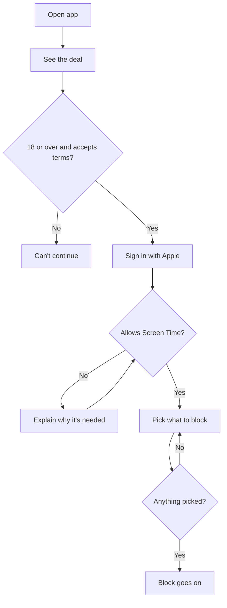
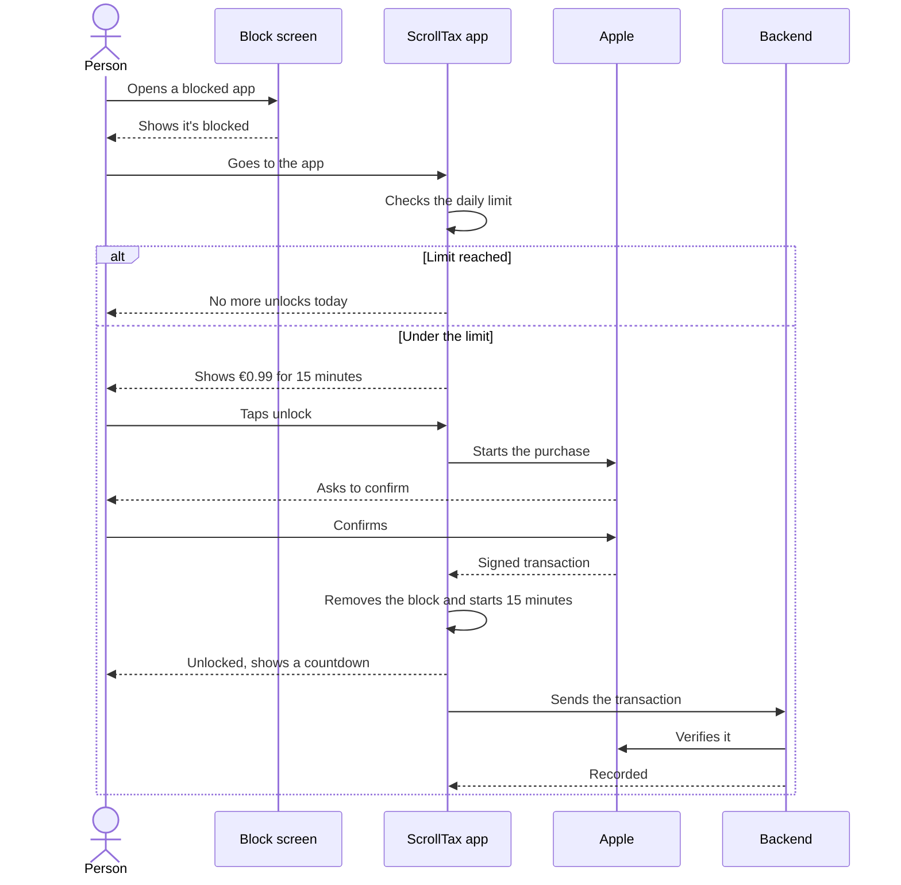
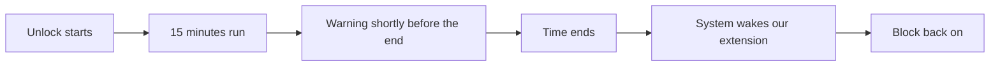
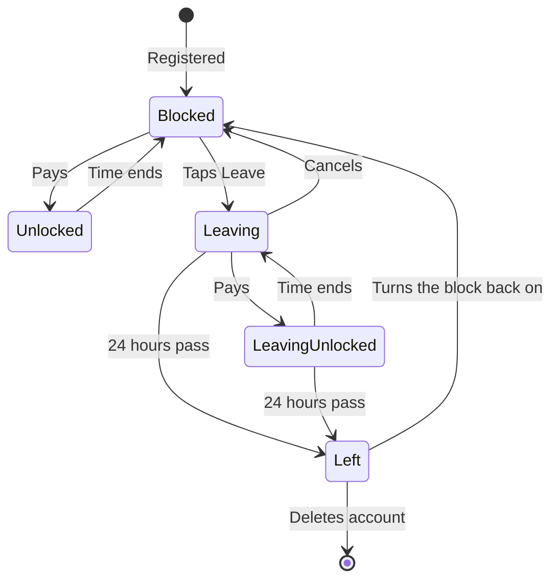
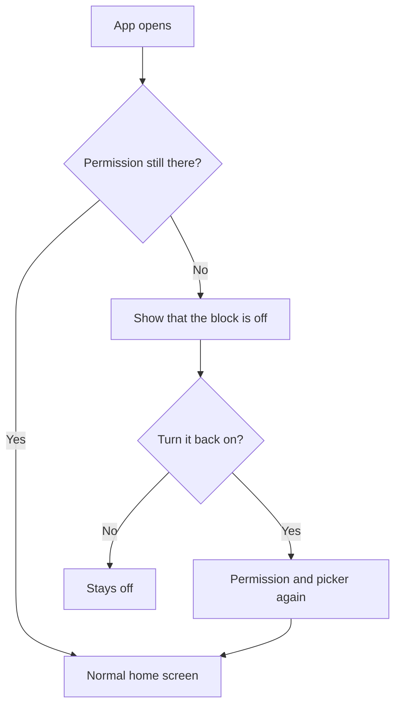
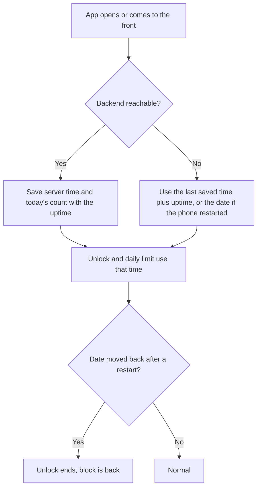
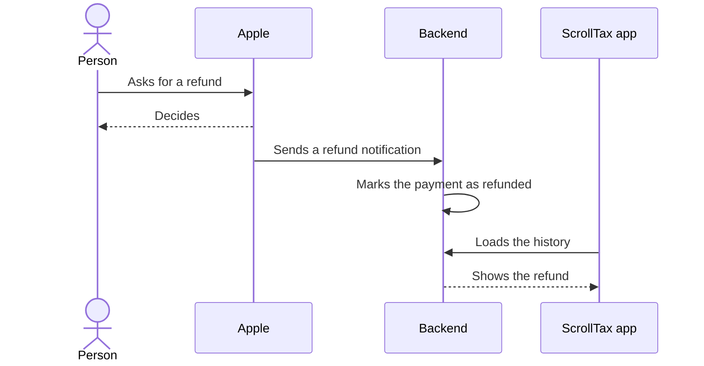

# Logical flows

The main flows in the first version, on iPhone. These follow the default settings. The way Apple's tools behave still needs confirming on a real device.

## 1. Register and get blocked

1. The person opens the app and sees the deal: everything is blocked, each unlock costs €0.99 for 15 minutes, and they can leave for free.
2. They confirm they're 18 or over and accept the terms.
3. They sign in with Apple.
4. They give the app Screen Time permission.
5. They use Apple's picker to select what's blocked, starting with the Social category.
6. The block goes on straight away.

## 2. Try to open social media and pay

1. The person opens a blocked app and sees the block screen.
2. They go to ScrollTax. The block screen itself can't take a payment.
3. The app checks if they're under the daily limit.
4. They see the price and confirm through Apple.
5. Apple takes the payment. The app checks the receipt and starts the unlock.
6. The app tells the backend afterwards. If the backend is down, it tries again later and the unlock still runs.

If the person cancels or the payment fails, nothing changes and the block stays on.

The phone saves the purchase in a queue before it does anything else, so a paid purchase can't be lost if the app is killed or the backend is down. The queue is sent again whenever the app opens. A purchase the backend refuses for good (a wrong product, say) is dropped so it can't block the ones behind it. If a purchase arrives over the daily limit, the backend keeps the record but gives no unlock.

## 3. The block comes back

1. When the unlock starts, the app schedules its end with Apple's system.
2. A notification warns the person shortly before the end.
3. The system wakes a small part of our app at the end, even if the main app is closed, and the block goes back on.

If the phone was off when the time ended, the block should be back on by the time it's used again. Phase 0 has to confirm this.

## 4. Daily limit

1. Each unlock counts toward today's total.
2. After the fourth unlock, the app stops offering more.
3. At midnight in the person's time zone, the count goes back to zero.

The app checks this on the device, so it works offline. The backend checks it again when the payment gets recorded.

## 5. Leave

1. The person taps Leave in settings.
2. The app explains that it's free and takes 24 hours.
3. The countdown starts. The block stays on, and they can still pay to unlock if they want.
4. They can cancel at any point.
5. When the 24 hours are up, the block is removed and no more unlocks are needed.

## 6. Delete account

1. The person taps Delete account in settings and confirms.
2. The block comes off straight away, and everything saved on the phone is wiped. This happens first, so a missing connection can't keep anyone blocked.
3. The app asks the backend to delete the account, and keeps retrying each time it opens until the backend confirms. The backend also revokes the Apple sign in (not built yet, see DESIGN.md).
4. Payment records stay only as long as tax law requires, with the link to the person removed.

This has no 24 hour wait. Deletion needs to be simple, and the person could delete the app anyway.

## 7. The block gets turned off

A person might remove the Screen Time permission or delete the app. We can't stop this and don't punish it.

## 8. The phone's date is wrong

A person might change the date on their phone to stretch an unlock or get a fresh day of unlocks.

1. When the app opens, and when it comes to the front, it asks the backend for the time and for today's unlock count. It saves both with the phone's uptime at that moment.
2. Inside the same boot, "now" is the backend's time plus the uptime that has passed. The date in Settings is ignored. The home screen says so when the two differ.
3. An unlock's end is kept on the uptime clock, so it ends on time whatever the date says.
4. After a restart the uptime clock starts again. If the date has been moved back past the latest time the phone saw, the unlock ends. The person can pay again.
5. The daily count is the larger of the phone's list and the backend's count, so a reinstall doesn't reset it.
6. If a purchase still reaches the backend over the limit, the backend keeps the record, gives no unlock, and the phone takes back the unlock it started.

## 9. Refund

1. The person asks Apple for a refund. Apple decides, not us.
2. Apple tells the backend.
3. The backend marks the payment as refunded, and the history shows this.
4. Any unlock already used stays used.

